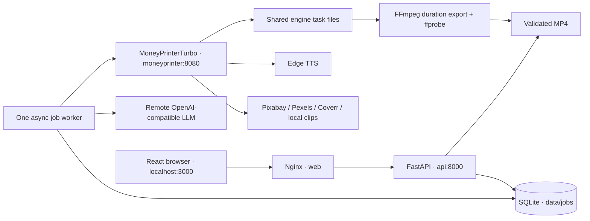

# Architecture

## Responsibilities

- **Web:** React, Vite, TypeScript. Topic form, optional script/local footage, job polling, errors, preview, download, and settings. Nginx proxies `/api` and `/health` to `api:8000`. No direct browser calls to an engine/provider; no external frontend assets.
- **API:** Typed requests/responses, app-owned UUIDs, input validation, media uploads, persistent state, safe file serving, and public configuration with secrets omitted. HTTP handlers do not wait for LLM or rendering work.
- **JobStore:** Standard-library SQLite with WAL and short transactions. Stores inputs, status, upstream ID, script/terms, submission intent, timestamps, errors, final path, and ffprobe metadata. No ORM/queue server.
- **JobWorker:** One asyncio task with a lifetime filesystem lock and one Uvicorn worker. Sequential FIFO dispatch; resumable LLM preparation; HTTP renderer submission and polling. Transient engine disconnects are retried. No new render is submitted until the upstream API confirms it is idle.
- **LLMAdapter / VideoGenerator:** One OpenAI-compatible chat call returns a narration script plus visual English stock-search terms when narration is empty. This is the sole script-generation owner. A supplied script always bypasses the LLM and uses the topic as the stock search phrase. Bare gateway URLs are normalized to `/v1`; explicit API paths remain intact. No provider-specific SDK or engine Python import.
- **StockConnections:** Small live video-search checks report each provider's connectivity and missing key name without exposing credentials. Results are cached for 60 seconds. This adapter checks connections; the engine continues to own search/downloads.
- **MoneyPrinterAdapter / Renderer:** HTTP-only integration. Supplies script/terms, language-appropriate Edge voice, Vietnamese-capable font, aspect ratio, one video, two rendering threads, and no music. Local materials are immutable uploaded MP4 IDs. MoneyPrinterTurbo handles TTS, materials, subtitles, and render logic.
- **Media service:** ffprobe rejects missing/invalid output and requires real video + audio streams. FFmpeg adjusts already-rendered video timing and audio tempo to the chosen duration, emits browser-compatible H.264/AAC MP4, and validates dimensions/duration before atomic promotion. Cancellation stops its subprocess and discards partial exports.

## Request flow

1. `POST /api/videos` validates configuration and uploaded IDs, commits a RECEIVED job, returns HTTP 202.
2. The worker confirms the renderer is idle and persists GENERATING_SCRIPT. It generates (or accepts) a script/terms plan and saves it.
3. PREPARING_MATERIALS verifies inputs/configuration and records submission intent before `POST /api/v1/videos`. The returned engine task ID is saved immediately.
4. Poll `GET /api/v1/tasks/{id}`. Upstream progress below 50 remains PREPARING_MATERIALS (voice, subtitles, footage); 50+ becomes RENDERING. Public progress uses upstream coarse milestones, then 95 during final export.
5. Upstream failure becomes FAILED with sanitized stage/error details. Upstream completion triggers final-file validation and export; only a valid final MP4 becomes COMPLETED with metadata and app-owned URLs.
6. The browser polls the backend every three seconds, previews `/api/videos/{id}/preview`, and downloads `/api/videos/{id}/download`.

## HTTP API

| Endpoint | Result |
| --- | --- |
| `GET /health` | API/SQLite/worker liveness; 503 if worker stopped |
| `GET /api/config/public` | Provider/model configuration, missing requirements, renderer/LLM/stock connection checks, stock providers and configured default source; no keys |
| `POST /api/videos` | Typed JSON: topic, language (`vi` default, `en`, `zh`), integer duration 30–60 (45 default), aspect ratio (`9:16` default or `16:9`), optional script, `footage_source` (`pixabay`, `pexels`, `coverr`, `local`; `pexels` default for existing API clients), optional uploaded material IDs |
| `GET /api/videos?limit=50` | Most recent jobs, up to 100 |
| `GET /api/videos/{uuid}` | Job status, timestamps, error, upstream ID, output metadata/URLs |
| `GET /api/videos/{uuid}/download` | Completed MP4 attachment |
| `GET /api/videos/{uuid}/preview` | Completed MP4 with Range support |
| `POST /api/materials` | Multipart MP4 upload; returns immutable ID/name/size |

Config errors return 503, invalid inputs 422, unknown jobs 404, unfinished downloads 409, and missing completed output 410. Complete files must remain within the output directory. Uploaded paths and upstream output URIs are checked against their allowed directories.

Only empty narration requires LLM configuration. Only stock footage requires the selected provider's key. Uploaded clips take precedence over the source selector and bypass all stock keys; Local selected without clips returns an explicit 422. The form uses the same requirements for disabling Generate; transient connection warnings do not disable it. Validation errors include the server's exact detail and field name.

## Recovery and limits

SQLite records persist through all container restarts. The worker always examines pending persisted jobs; no volatile queue is the source of truth. Known engine IDs resume polling. Pre-submission jobs resume from saved plans. An ambiguous submission is failed rather than repeated because upstream lacks client task IDs/idempotency support.

The pinned engine uses in-memory task state when Redis is disabled. If its task ID returns 404, only `storage/tasks/<task-id>/final-1.mp4` can be recovered after validation/export. Missing or invalid final artifacts fail explicitly. This is reconciliation, not a claim that killed engine work can resume.

The submission deadline starts when the renderer request is sent. On timeout the job fails; the renderer may still finish, and its active slot must clear before more work is sent. Queue wait time is not counted. Completed files are validated before status promotion; later deletion of output files produces HTTP 410.

This is a single-user, single-host MVP. Bind-mounted storage and a process lock prohibit multiple dispatcher processes against the same data directory. Stock/TTS services may fail independently of configuration checks. The duration export time-stretches narration; supplied scripts should match the target length. No heavyweight local model is invoked or downloaded; Edge subtitle failures do not fall back to Whisper in this pinned upstream.
